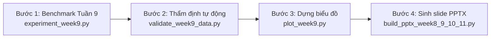

# Kế Hoạch Chạy Lại Thực Nghiệm & Cập Nhật Báo Cáo Cho Nhóm

> **Mã đề tài**: CNTT-KLCN142 — Trường Đại học Công Thương TP.HCM  
> **Tài liệu bàn giao**: Hướng dẫn nhóm thực hiện chạy lại toàn bộ thực nghiệm trên tập dữ liệu đã làm sạch (`data/processed/cleaned_food_nutrition.csv`), cập nhật hình ảnh trực quan (Heatmap 7 ngày) và tái tạo slide báo cáo PowerPoint để giải trình trước Hội đồng.

---

## 1. Tóm Tắt Trạng Thái Kỹ Thuật

Nhóm đã hoàn thành việc xây dựng công cụ tiền xử lý dữ liệu và kiểm thử bảo vệ:
- **Tập dữ liệu sạch**: `data/processed/cleaned_food_nutrition.csv` (13.709 món ăn đạt chuẩn sinh lý; đã loại bỏ 2.220 món rác, ngoại lai và thịt sống).
- **Minh chứng chuẩn hóa dữ liệu**: `data/processed/cleaning_report.md` (Báo cáo phễu lọc 8 bước và bảo đảm định luật bảo toàn khối lượng).
- **Bộ kiểm thử (Test suite)**: **258/258 unit tests PASSED (100%)**.
- **Cơ chế nạp dữ liệu**: Module `src/utils/data_loader.py` cùng các script thực nghiệm `demo_week8.py`, `experiment_week9.py` đã hỗ trợ tham số `--data-path` trỏ trực tiếp đến dataset sạch.

---

## 2. Quy Trình 4 Bước Chạy Lại Thực Nghiệm (Pipeline Execution)

Thành viên phụ trách kỹ thuật chỉ cần mở terminal, kích hoạt môi trường ảo `venv` và thực hiện tuần tự pipeline sau:



> **Lưu ý kiểm tra nhanh (Tùy chọn)**: Nếu muốn kiểm tra trực quan món ăn mẫu 1 ngày của P1 trên terminal trước khi chạy benchmark, có thể chạy lệnh smoke:
> `python scripts/demo_week8.py --outer-algo idbo --inner-algo idbo --outer-iter 10 --outer-agents 8 --inner-iter 10 --inner-agents 8 --seed 8003`.
> *(Lệnh này chỉ hiển thị ra terminal để quan sát, không ghi file dữ liệu vào pipeline).*

---

### Bước 1: Chạy Benchmark 7 Ngày Tuần 9 (Multi-Profile)
*Mục đích*: Chạy chu kỳ 7 ngày cho Profile P1, P2 (tiểu đường), P3 (tăng huyết áp) trên dataset sạch.

```bash
source venv/bin/activate

python scripts/experiment_week9.py \
  --runs 5 \
  --profiles p1 p2 p3 \
  --algos idbo dbo \
  --days 7 \
  --outer-iter 15 --outer-agents 8 \
  --inner-iter 15 --inner-agents 8 \
  --base-seed 9000
```
- **Thời gian chạy ước tính**: ~3 - 5 phút (trên CPU).
- **Tập tin đầu ra được cập nhật**:
  - `experiments/week9/weekly_runs.csv`
  - `experiments/week9/weekly_summary.csv`
  - `experiments/week9/diversity_score.csv`

---

### Bước 2: Thẩm định tự động số liệu thực đơn (Audit Gate)
*Mục đích*: Dùng công cụ kiểm định tự động (`scripts/validate_week9_data.py`) để thẩm định 210 ngày mô phỏng về Natri, Xơ và Calo trước khi vẽ hình hay đưa vào slide.

```bash
python scripts/validate_week9_data.py \
  --input experiments/week9/weekly_runs.csv \
  --outdir experiments/week9
```
- **Thời gian chạy**: ~1 giây.
- **Tiêu chuẩn nghiệm thu**:
  - `experiments/week9/validation_summary.md` ghi nhận tỷ lệ đáp ứng Calo $\pm 10\%$ đạt $\ge 95\%$.
  - Chất xơ trung bình đạt chuẩn DRI.
  - Natri ở bệnh nhân cao huyết áp (P3) khống chế nghiêm ngặt $< 1.500\text{ mg/ngày}$ ($> 95\%$ ngày tuân thủ).
  - Xuất file kiểm định: `experiments/week9/validation_report.csv`.

---

### Bước 3: Dựng lại biểu đồ trực quan (Heatmap & Radar)
*Mục đích*: Vẽ lại biểu đồ Heatmap dinh dưỡng 7 ngày và biểu đồ radar dựa trên số liệu mới từ `weekly_runs.csv`.

```bash
python scripts/plot_week9.py
```
- **Thời gian chạy**: ~2 giây.
- **Tập tin hình ảnh được cập nhật**:
  - `experiments/week9/fig_heatmap_nutrition_7days.png`
  - `experiments/week9/fig_barchart_profiles_p1_p2_p3.png`
  - `experiments/week9/fig_radar_options_abc.png`

---

### Bước 4: Tái tạo Slide Báo Cáo PowerPoint
*Mục đích*: Tự động cập nhật bảng thực đơn mới, số liệu mới và hình ảnh heatmap sạch vào các slide thuyết trình chính thức.

```bash
python scripts/build_pptx_week8_9_10_11.py
```
- **Tập tin slide được cập nhật trực tiếp**:
  - `docs/slides/Slide_Bao_Cao_Tuan_8_9_10_11_DBO_IDBO.pptx`
  - `docs/slides/Slide_Bao_Cao_Tuan_9_10_11_DBO_IDBO.pptx`

---

## 3. Bảng Phân Công Nhiệm Vụ Trong Nhóm

| Thành viên | Trách nhiệm chính | Chi tiết công việc cụ thể |
|---|---|---|
| **Thành viên 1** (Kỹ thuật/Chạy code) | Chạy Pipeline thực nghiệm | - Kích hoạt `venv` và chạy Bước 1 (`experiment_week9.py`).<br>- Giám sát terminal log đảm bảo không có cảnh báo/lỗi.<br>- Lưu log chạy vào `experiments/week9/run_log.txt`. |
| **Thành viên 2** (Kiểm tra dữ liệu) | Thẩm định số liệu thực đơn | - Chạy Bước 2 (`python scripts/validate_week9_data.py`).<br>- Đọc file báo cáo tự động `experiments/week9/validation_summary.md`.<br>- Đối chiếu 3 chỉ tiêu: Calo ($\pm 10\%$), Xơ DRI, và Natri bệnh nhân P3 ($< 1.500\text{ mg}$). |
| **Thành viên 3** (Trình bày/Slide) | Kiểm tra slide & Đối chiếu hình ảnh | - Chạy Bước 3 & Bước 4 để cập nhật biểu đồ và slide PowerPoint.<br>- Mở slide trong `docs/slides/` kiểm tra Slide 3, Slide 5, Slide 6.<br>- Đảm bảo hình ảnh mới nhất, không dùng file rời rạc có đuôi lạ. |

---

## 4. Kịch Bản Q&A Trả Lời Hội Đồng (Cheat-Sheet Cho Nhóm)

### ❓ Câu hỏi 1: "Tại sao ở slide cũ lượng Natri ngày 1 vọt lên 7.898 mg (343%) và ngày 6 vọt 260%?"
> **Trả lời**: *"Dạ thưa Thầy/Cô, nhóm đã truy vết mã nguồn và phát hiện nguyên nhân gốc xuất phát từ tập dữ liệu thô USDA Branded Foods bị lỗi đơn vị nhập liệu từ nhà sản xuất (ví dụ món Cá cơm ngâm dầu `USDA_2110512` ghi nhận **4.690.000 mg natri/100g**, hay món mì ghi nhận đạm **131g/100g**). Đồng thời, ở phiên bản trước Profile P1 là người khỏe mạnh nên hàm ràng buộc chưa áp trần natri bệnh lý, dẫn tới thuật toán tự do chọn các món mặn/lỗi đơn vị này để tối ưu calo.*  
> *Nhóm đã khắc phục triệt để bằng cách xây dựng pipeline tiền xử lý `clean_dataset.py`, áp trần natri tối đa 3.000 mg/100g cho kho dữ liệu và bảo đảm định luật bảo toàn khối lượng. Nhờ đó, các trường hợp lỗi dữ liệu hàng triệu mg đã bị triệt tiêu hoàn toàn, đưa hàm lượng muối về dải sinh lý thực tế."*

---

### ❓ Câu hỏi 2: "Tại sao lại đề xuất món thịt chim cút sống, đùi gà 25g hay Tahini 85g?"
> **Trả lời**: *"Dạ thưa Thầy/Cô:*  
> *1. **Về món chim cút sống (`Quail, breast, raw`)**: Do cơ sở dữ liệu USDA lưu trữ cả nguyên liệu thô và gắn nhãn `, raw`. Nhóm đã bổ sung bộ lọc tiền xử lý Edibility, chặn hoàn toàn các loại thịt, cá, gia cầm và nội tạng sống trước khi đưa vào candidate pool.*  
> *2. **Về đùi gà 25g & Tahini 85g**: Trước đây khoảng chặn khẩu phần được đặt chung `[25g, 350g]` cho mọi món. Nhóm đã nghiên cứu kiến trúc `ROLE_PORTION_BOUNDS` trong `dish_category.py` để phân loại vai trò ẩm thực: món đạm chính (Main Protein) cần định lượng tối thiểu 60g - 180g, và bơ hạt/gia vị chỉ được dùng làm phụ gia (5g - 30g), không thể đóng vai trò bữa ăn độc lập."*

---

### ❓ Câu hỏi 3: "Nhóm chứng minh quy trình chuẩn hóa và xử lý dữ liệu như thế nào?"
> **Trả lời**: *"Dạ thưa Thầy/Cô, nhóm đã chuẩn hóa quy trình thành pipeline tự động có khả năng tái lập 100% qua script `scripts/clean_dataset.py` và báo cáo `cleaning_report.md`:*  
> *- Ban đầu kho dữ liệu có **15.929 món**.*  
> *- Qua phễu lọc 8 bước (lọc ngoại lai natri, calo > 900, bảo toàn khối lượng, loại thịt sống, gia vị, bột công nghiệp), nhóm đã loại bỏ **2.220 món rác** (13,9%).*  
> *- Tập dữ liệu sạch hiện tại gồm **13.709 món** đạt chuẩn sinh lý, được bảo vệ bởi test suite tự động của hệ thống."*

---

## 5. Bảng Đối Chiếu Chỉ Số Dinh Dưỡng Trước & Sau Chuẩn Hóa

Nhóm có thể đưa trực tiếp bảng này vào Slide 3 hoặc báo cáo để làm minh chứng:

| Chỉ số dinh dưỡng | Trước chuẩn hóa (Min - Max) | Sau chuẩn hóa (Min - Max) | Đánh giá & Trạng thái |
|---|---|---|---|
| **Năng lượng (kcal/100g)** | 0.0 - 901.1 | **0.0 - 900.0** | Không vượt trần lipid thuần |
| **Đạm (g/100g)** | 0.0 - 167.0 | **0.0 - 88.3** | Đã loại món lỗi ghi nhận 131g đạm/100g |
| **Tinh bột (g/100g)** | -0.7 - 250.0 | **0.0 - 100.0** | Đã loại món lỗi ghi nhận 250g carbs/100g |
| **Chất béo (g/100g)** | 0.0 - 100.0 | **0.0 - 100.0** | Hợp chuẩn khối lượng |
| **Chất xơ (g/100g)** | 0.0 - 100.0 | **0.0 - 79.0** | Hợp chuẩn xơ tự nhiên |
| **Natri (mg/100g)** | 0.0 - 4.690.000.0 | **0.0 - 3.000.0** | **Đã loại bỏ hoàn toàn các lỗi ngoại lai triệu mg** |
| **Thịt động vật sống** | Tồn tại (1.050 món) | **0 món (Đã chặn hoàn toàn)** | Đáp ứng 100% tính khả thi ẩm thực |
