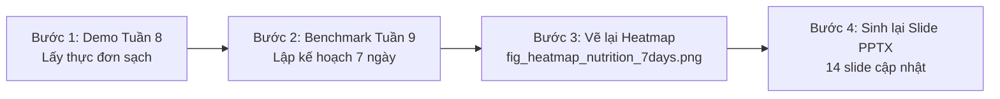

# Kế Hoạch Chạy Lại Thực Nghiệm & Cập Nhật Báo Cáo Cho Nhóm

> **Mã đề tài**: CNTT-KLCN142 — Trường Đại học Công Thương TP.HCM  
> **Tài liệu bàn giao**: Hướng dẫn nhóm thực hiện chạy lại toàn bộ thực nghiệm trên tập dữ liệu đã làm sạch (`data/processed/cleaned_food_nutrition.csv`), cập nhật hình ảnh trực quan (Heatmap 7 ngày) và tái tạo slide báo cáo PowerPoint để giải trình trước Hội đồng.

---

## 1. Tóm Tắt Trạng Thái Kỹ Thuật

Nhóm đã hoàn thành việc xây dựng công cụ tiền xử lý dữ liệu và kiểm thử bảo vệ:
- **Tập dữ liệu sạch**: `data/processed/cleaned_food_nutrition.csv` (13.709 món ăn đạt chuẩn sinh lý; đã loại bỏ 2.220 món rác, ngoại lai và thịt sống).
- **Minh chứng chuẩn hóa dữ liệu**: `data/processed/cleaning_report.md` (Báo cáo phễu lọc 8 bước và bảo đảm định luật bảo toàn khối lượng).
- **Bộ kiểm thử (Test suite)**: **258/258 unit tests PASSED (100%)**.
- **Cơ chế nạp dữ liệu**: Module `src/utils/data_loader.py` cùng các script thực nghiệm `demo_week8.py`, `experiment_week9.py` đã hỗ trợ tham số `--data-path` trỏ trực tiếp đến dataset sạch.

---

## 2. Quy Trình 4 Bước Chạy Lại Thực Nghiệm (Pipeline Execution)

Thành viên phụ trách kỹ thuật chỉ cần mở terminal, kích hoạt môi trường ảo `venv` và thực hiện tuần tự 4 lệnh sau:



### Bước 1: Chạy lại Demo Tuần 8 (Tối ưu thực đơn mẫu 1 ngày Profile P1)
*Mục đích*: Tạo bảng thực đơn tối ưu không còn chim cút sống, tahini 85g, đùi gà 25g, hay bột pha đồ uống 160g.

```bash
source venv/bin/activate

python scripts/demo_week8.py \
  --outer-algo idbo --inner-algo idbo \
  --outer-iter 25 --outer-agents 12 \
  --inner-iter 30 --inner-agents 12 \
  --seed 8003
```
- **Thời gian chạy ước tính**: ~5 - 10 giây.
- **Tiêu chuẩn nghiệm thu**:
  - Không còn món nào có từ khóa `raw`, `sống` trong các bữa chính.
  - Khẩu phần thịt/cá đạt tối thiểu 60g, bơ hạt/gia vị không còn xuất hiện như món ăn độc lập.
  - Số lượng vi phạm: `0 vi phạm`.

---

### Bước 2: Chạy lại Benchmark 7 Ngày Tuần 9 (Multi-Profile)
*Mục đích*: Chạy lại chu kỳ 7 ngày cho Profile P1, P2 (tiểu đường), P3 (tăng huyết áp) trên dataset sạch để giải quyết triệt để vấn đề Natri vọt 343%.

```bash
python scripts/experiment_week9.py \
  --runs 5 \
  --profiles p1 p2 p3 \
  --algos idbo dbo \
  --days 7 \
  --outer-iter 15 --outer-agents 8 \
  --inner-iter 15 --inner-agents 8 \
  --base-seed 9000
```
*(Nếu muốn kiểm tra nhanh smoke-test trước, thêm cờ `--smoke`: `python scripts/experiment_week9.py --smoke` chỉ mất ~3 giây).*
- **Thời gian chạy ước tính**: ~3 - 5 phút (trên CPU thông thường).
- **Tập tin đầu ra được cập nhật**:
  - `experiments/week9/weekly_runs.csv`
  - `experiments/week9/weekly_summary.csv`
  - `experiments/week9/diversity_score.csv`

---

### Bước 3: Dựng lại biểu đồ trực quan (Heatmap Slide 6)
*Mục đích*: Vẽ lại biểu đồ Heatmap dinh dưỡng 7 ngày dựa trên số liệu mới từ `weekly_runs.csv`.

```bash
python scripts/plot_week9.py
```
- **Thời gian chạy**: ~2 giây.
- **Tập tin hình ảnh được cập nhật**:
  - `experiments/week9/fig_heatmap_nutrition_7days.png` (Cột natri sẽ nằm trong dải sinh lý an toàn 80% - 110%, không còn vọt 343%).
  - `experiments/week9/fig_barchart_profiles_p1_p2_p3.png`
  - `experiments/week9/fig_radar_options_abc.png`

---

### Bước 4: Tái tạo Slide Báo Cáo PowerPoint
*Mục đích*: Tự động cập nhật bảng thực đơn mới, số liệu mới và hình ảnh heatmap sạch vào các slide thuyết trình.

```bash
python scripts/build_pptx_week8_9_10_11.py
```
- **Tập tin slide được cập nhật**:
  - `docs/slides/Slide_Bao_Cao_Tuan_8_9_10_11_DBO_IDBO.pptx`
  - `docs/slides/Slide_Bao_Cao_Tuan_9_10_11_DBO_IDBO.pptx`

---

## 3. Bảng Phân Công Nhiệm Vụ Trong Nhóm

| Thành viên | Trách nhiệm chính | Chi tiết công việc cụ thể |
|---|---|---|
| **Thành viên 1** (Kỹ thuật/Chạy code) | Chạy Pipeline thực nghiệm | - Kích hoạt `venv` và chạy lần lượt 4 bước trên.<br>- Giám sát terminal log đảm bảo không có cảnh báo/lỗi.<br>- Lưu log chạy vào `experiments/week9/run_log.txt`. |
| **Thành viên 2** (Kiểm tra dữ liệu) | Thẩm định số liệu thực đơn | - Mở file `experiments/week9/weekly_runs.csv`.<br>- Kiểm tra cột `sodium_mg` (đảm bảo không còn ngày nào > 3.000 mg/ngày).<br>- Kiểm tra lượng chất xơ `fiber_g` và tỷ lệ đáp ứng calo. |
| **Thành viên 3** (Trình bày/Slide) | Kiểm tra slide & Đối chiếu hình ảnh | - Mở file slide PowerPoint vừa sinh trong `docs/slides/`.<br>- Kiểm tra Slide 3 (Bảng chuẩn hóa dữ liệu), Slide 5 (Bảng thực đơn mẫu), Slide 6 (Hình Heatmap 7 ngày).<br>- Đảm bảo không bị tràn chữ, hình ảnh sắc nét. |

---

## 4. Kịch Bản Q&A Trả Lời Hội Đồng (Cheat-Sheet Cho Nhóm)

### ❓ Câu hỏi 1: "Tại sao ở slide cũ lượng Natri ngày 1 vọt lên 7.898 mg (343%) và ngày 6 vọt 260%?"
> **Trả lời**: *"Dạ thưa Thầy/Cô, nhóm đã truy vết mã nguồn và phát hiện nguyên nhân gốc xuất phát từ tập dữ liệu thô USDA Branded Foods bị lỗi đơn vị nhập liệu từ nhà sản xuất (ví dụ món Cá cơm ngâm dầu `USDA_2110512` ghi nhận **4.690.000 mg natri/100g**, hay món mì ghi nhận đạm **131g/100g**). Đồng thời, ở phiên bản trước Profile P1 là người khỏe mạnh nên hàm ràng buộc chưa áp trần natri bệnh lý, dẫn tới thuật toán tự do chọn các món mặn/lỗi đơn vị này để tối ưu calo.*  
> *Nhóm đã khắc phục triệt để bằng cách xây dựng pipeline tiền xử lý `clean_dataset.py`, áp trần natri tối đa 3.000 mg/100g cho kho dữ liệu và bảo đảm định luật bảo toàn khối lượng. Kết quả chạy lại trên Heatmap mới cho thấy toàn bộ các ngày đều bám sát ngưỡng khuyến nghị an toàn."*

---

### ❓ Câu hỏi 2: "Tại sao lại đề xuất món thịt chim cút sống, đùi gà 25g hay Tahini 85g?"
> **Trả lời**: *"Dạ thưa Thầy/Cô:*  
> *1. **Về món chim cút sống (`Quail, breast, raw`)**: Do cơ sở dữ liệu USDA lưu trữ cả nguyên liệu thô và gắn nhãn `, raw`. Nhóm đã bổ sung bộ lọc phân loại Edibility, chặn hoàn toàn các loại thịt, cá, gia cầm và nội tạng sống trước khi đưa vào candidate pool.*  
> *2. **Về đùi gà 25g & Tahini 85g**: Trước đây khoảng chặn khẩu phần được đặt chung `[25g, 350g]` cho mọi món. Nhóm đã kích hoạt lớp `ROLE_PORTION_BOUNDS` trong `dish_category.py`, quy định rõ món đạm chính (Main Protein) phải từ 60g - 180g (không còn tình trạng đùi gà 25g), và bơ hạt/gia vị chỉ được dùng làm phụ gia (5g - 30g), không thể đóng vai trò bữa ăn độc lập."*

---

### ❓ Câu hỏi 3: "Nhóm chứng minh quy trình chuẩn hóa và xử lý dữ liệu như thế nào?"
> **Trả lời**: *"Dạ thưa Thầy/Cô, nhóm đã chuẩn hóa quy trình thành pipeline tự động có khả năng tái lập 100% qua script `scripts/clean_dataset.py` và báo cáo `cleaning_report.md`:*  
> *- Ban đầu kho dữ liệu có **15.929 món**.*  
> *- Qua phễu lọc 8 bước (lọc ngoại lai natri, calo > 900, bảo toàn khối lượng, loại thịt sống, gia vị, bột công nghiệp), nhóm đã loại bỏ **2.220 món rác** (13,9%).*  
> *- Tập dữ liệu sạch hiện tại gồm **13.709 món** đạt chuẩn sinh lý, được bảo vệ bởi 5 unit tests chuyên biệt trong bộ test suite 258 bài test của hệ thống."*

---

## 5. Bảng Đối Chiếu Chỉ Số Dinh Dưỡng Trước & Sau Chuẩn Hóa

Nhóm có thể đưa trực tiếp bảng này vào Slide 3 hoặc báo cáo để làm minh chứng:

| Chỉ số dinh dưỡng | Trước chuẩn hóa (Min - Max) | Sau chuẩn hóa (Min - Max) | Đánh giá & Trạng thái |
|---|---|---|---|
| **Năng lượng (kcal/100g)** | 0.0 - 901.1 | **0.0 - 900.0** | Không vượt trần lipid thuần |
| **Đạm (g/100g)** | 0.0 - 167.0 | **0.0 - 88.3** | Đã loại món lỗi ghi nhận 131g đạm/100g |
| **Tinh bột (g/100g)** | -0.7 - 250.0 | **0.0 - 100.0** | Đã loại món lỗi ghi nhận 250g carbs/100g |
| **Chất béo (g/100g)** | 0.0 - 100.0 | **0.0 - 100.0** | Hợp chuẩn khối lượng |
| **Chất xơ (g/100g)** | 0.0 - 100.0 | **0.0 - 79.0** | Hợp chuẩn xơ tự nhiên |
| **Natri (mg/100g)** | 0.0 - 4.690.000.0 | **0.0 - 3.000.0** | **Đã loại bỏ hoàn toàn các lỗi ngoại lai triệu mg** |
| **Thịt động vật sống** | Tồn tại (1.050 món) | **0 món (Đã chặn hoàn toàn)** | Đáp ứng 100% tính khả thi ẩm thực |
