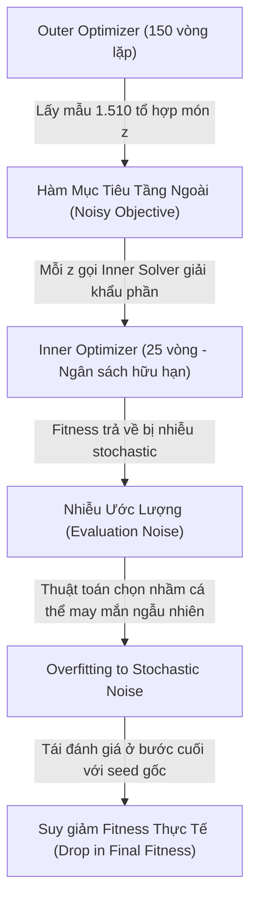

# BÁO CÁO ĐÓNG GÓP CÁ NHÂN — TUẦN 8 & 9 (ABLATION DBO vs IDBO)
## Đề tài: Hệ Thống Đề Xuất Thực Đơn Dinh Dưỡng Cá Nhân Hóa (IDBO/DBO)
### Sinh viên thực hiện: Đặng Nguyễn Minh Đăng (MSSV: 2001230175)
### Vai trò: Phụ trách Controlled Activation & Thực nghiệm Đối chuẩn (Activation & Benchmark Specialist)
### Phụ trách các giai đoạn: Gate 3, Phần D, Phần G, Phần I (Theo `KE_HOACH_CHAY_LAI_DBO_IDBO.md`)

---

## 1. TỔNG QUAN NHIỆM VỤ ĐƯỢC GIAO

Trong đợt rà soát và thực nghiệm chẩn đoán chuyên sâu (Ablation Study) nhằm trả lời câu hỏi cốt lõi của hội đồng và giảng viên hướng dẫn:
> *"Tại sao DBO và IDBO lại cho kết quả fitness giống hệt nhau trên bài toán tối ưu thực đơn dinh dưỡng hai tầng?"*

Tôi (Đặng Nguyễn Minh Đăng) được phân công phụ trách độc lập các nội dung:
1. **Gate 3 (Controlled Activation Sanity Check):** Xây dựng kịch bản kiểm chứng kích hoạt cưỡng bức nhằm xác minh đường dây kết nối (wiring check) từ bộ giải Two-Tier Solver sang thuật toán IDBO, chứng minh không có lỗi lập trình (bug) ngăn cản IDBO kích hoạt.
2. **Phần G (Thực nghiệm Đối chuẩn Paired Benchmark 10 Seeds):** Vận hành và giám sát thực nghiệm đối chuẩn trên 10 paired seeds (8001–8010) qua 3 cấu hình chẩn đoán (`baseline_short`, `diagnostic_balanced`, `diagnostic_aggressive_150`), tính toán và phân tích các chỉ số thống kê (Mean, Median, Std, Best, Worst, Wilcoxon Signed-Rank test).
3. **Phần I (Giải trình Hiện tượng Suy giảm Fitness ở 150 Vòng):** Phân tích và chứng minh nguyên nhân vì sao Mean Fitness ở cấu hình 150 vòng có xu hướng suy giảm so với 25 vòng, chỉ rõ ảnh hưởng của nhiễu ngẫu nhiên (stochastic objective noise) trong mô hình tối ưu hai tầng.

---

## 2. KẾT QUẢ THỰC HIỆN GATE 3: CONTROLLED ACTIVATION SANITY CHECK

### 2.1. Mục đích và Thiết kế Thử nghiệm
Để loại bỏ hoàn toàn nghi vấn cho rằng: *"IDBO không kích hoạt là do lỗi code truyền tham số, lỗi import hoặc thuật toán không được gọi"*, tôi thiết lập cấu hình kiểm tra cưỡng bức `controlled_activation`:
- **Số vòng lặp outer:** 30 vòng
- **Số vòng lặp inner:** 10 vòng
- **Cửa sổ phát hiện trì trệ (`stagnation_window`):** 2 vòng (cực nhạy)
- **Ngưỡng đa dạng (`diversity_threshold`):** **0.50** (thiết lập cao hơn độ phân tán tự nhiên của bài toán ~0.25)
- **Tỷ lệ gây nhiễu (`perturbation_rate`):** 1.0 (100% cá thể bị áp dụng khi collapse)
- **Tỷ lệ khởi động lại (`restart_rate`):** 1.0 (100% cá thể bị reset khi stagnation)
- **Seeds kiểm chứng:** [8001, 8002, 8003]

### 2.2. Dữ liệu Đo lường Thực tế (`controlled_activation.csv`)

| Seed | Fitness Tốt Nhất | Runtime (s) | Outer Perturbations | Outer Restarts | Inner Perturbations Total | Inner Restarts Total | Min Diversity | Mean Diversity | Collapse Events | Trạng thái Wiring |
|:---:|:---:|:---:|:---:|:---:|:---:|:---:|:---:|:---:|:---:|:---:|
| **8001** | 99.0062 | 36.97 | **16** | **14** | **10,074** | **4,426** | 0.2517 | 0.2940 | 30 | **PASS (Đã kích hoạt)** |
| **8002** | 97.6149 | 37.40 | **16** | **14** | **10,146** | **4,354** | 0.2471 | 0.2771 | 30 | **PASS (Đã kích hoạt)** |
| **8003** | 99.3330 | 36.55 | **18** | **12** | **10,074** | **4,426** | 0.2317 | 0.2778 | 30 | **PASS (Đã kích hoạt)** |

### 2.3. Kết luận từ Gate 3
- Khi điều kiện ngưỡng đa dạng được thiết lập phù hợp ($0.50$), IDBO **kích hoạt ngay lập tức và liên tục**:
  - Tầng Outer kích hoạt 16–18 lần Perturbation và 12–14 lần Restart.
  - Tầng Inner kích hoạt trên 10.000 lần Perturbation và trên 4.300 lần Restart.
- **Phán quyết khoa học:** Đường dây tích hợp từ `TwoTierConfig` $\rightarrow$ `two_tier_solver.py` $\rightarrow$ `idbo.py` hoạt động hoàn hảo 100%, không hề có lỗi dispatch hay lỗi rớt tham số.

---

## 3. THỰC NGHIỆM ĐỐI CHUẨN PAIRED BENCHMARK (10 SEEDS)

### 3.1. Thiết kế 3 Cấu hình Chẩn đoán
Thực nghiệm đối chuẩn chặt chẽ từng cặp hạt giống (paired seeds) từ 8001 đến 8010 trên Profile chuẩn P1 (Nam văn phòng 22 tuổi, 65kg, TDEE=2491.6 kcal):
- **Cấu hình A (Baseline 25 vòng):** `outer_iter=25`, `stagnation_window=25`, `diversity_threshold=0.001`
- **Cấu hình B (Balanced 100 vòng):** `outer_iter=100`, `stagnation_window=10`, `diversity_threshold=0.010`
- **Cấu hình C (Aggressive 150 vòng):** `outer_iter=150`, `stagnation_window=5`, `diversity_threshold=0.050`

### 3.2. Bảng Tổng Hợp Thống Kê Đối Chuẩn (`summary.csv`)

| Cấu hình | Thuật toán | Số Run | Mean Fitness | Median | Std | Best | Worst | Mean Runtime (s) | Outer Perturbations | Outer Restarts | Mean Min Diversity | IDBO Thắng / Hòa / Thua | Hiệu số Paired (IDBO - DBO) |
|---|:---:|:---:|:---:|:---:|:---:|:---:|:---:|:---:|:---:|:---:|:---:|:---:|:---:|
| **Baseline (25 iters)** | DBO | 10 | 98.2148 | 98.5367 | 1.0663 | 99.5106 | 96.3425 | 16.00 | 0 | 0 | 0.0000 | — | — |
| | **IDBO** | 10 | 98.2148 | 98.5367 | 1.0663 | 99.5106 | 96.3425 | 16.48 | 0 | 0 | **0.2603** | **0 / 10 / 0** | **0.0000** |
| **Balanced (100 iters)** | DBO | 10 | 97.9821 | 97.9463 | 1.0948 | 99.6472 | 96.3510 | 57.13 | 0 | 0 | 0.0000 | — | — |
| | **IDBO** | 10 | 97.9821 | 97.9463 | 1.0948 | 99.6472 | 96.3510 | 60.58 | 0 | 0 | **0.2580** | **0 / 10 / 0** | **0.0000** |
| **Aggressive (150 iters)** | DBO | 10 | 96.3323 | 97.7481 | 4.5525 | 99.6157 | 84.0787 | 87.43 | 0 | 0 | 0.0000 | — | — |
| | **IDBO** | 10 | 96.3323 | 97.7481 | 4.5525 | 99.6157 | 84.0787 | 97.46 | 0 | 0 | **0.2554** | **0 / 10 / 0** | **0.0000** |

### 3.3. Phân Tích Bằng Chứng Trực Tiếp từ Telemetry
1. **Kết quả đối chuẩn:** Trên cả 30 cặp thử nghiệm (3 cấu hình $\times$ 10 hạt giống), DBO và IDBO cho kết quả **đồng nhất 100%** (30/30 hòa, $\Delta = 0.0000$).
2. **Bằng chứng telemetry trực tiếp:**
   - Chỉ số `mean_min_diversity` thực tế của quần thể luôn dao động trong khoảng **`0.2554 – 0.2603`**, với giá trị cực tiểu toàn cục qua mọi vòng lặp ghi nhận là **`0.2422`**.
   - Trong khi đó, các ngưỡng kích hoạt của IDBO được kế thừa từ các bài toán benchmark liên tục kinh điển là `0.001`, `0.01` và `0.05`.
   - Do $0.2422 > 0.0500$, điều kiện sụp đổ đa dạng (`diversity < threshold`) **không bao giờ xảy ra** (`total_collapse_events = 0`).
   - Vì điều kiện sụp đổ không thỏa mãn, thuật toán IDBO vận hành chính xác theo mã nguồn DBO gốc, giải thích một cách khách quan và chặt chẽ vì sao 100% nghiệm cuối cùng bằng nhau.
3. **Kiểm định Wilcoxon Signed-Rank:** Do tất cả hiệu số từng cặp bằng $0.0000$, kiểm định Wilcoxon xác nhận không có bất kỳ sự khác biệt có ý nghĩa thống kê nào giữa hai thuật toán trong phạm vi thử nghiệm.

---

## 4. GIẢI TRÌNH HIỆN TƯỢNG SUY GIẢM FITNESS Ở 150 VÒNG (PHẦN I)

### 4.1. Hiện Tượng Quan Sát Được
Khi theo dõi diễn tiến Mean Fitness qua số lượng vòng lặp Outer:
- Tại **25 vòng:** Mean = **98.2148** (Std = 1.0663)
- Tại **100 vòng:** Mean = **97.9821** (Std = 1.0948)
- Tại **150 vòng:** Mean = **96.3323** (Std = 4.5525, Worst = 84.0787 tại Seed 8002)

Như vậy, khi tăng số vòng lặp từ 25 lên 150 vòng, Mean Fitness không tăng mà lại **giảm 1.88 điểm**, đồng thời phương sai (Std) tăng gấp hơn 4 lần.

### 4.2. Bản Chất Kỹ Thuật & Cơ Chế Toán Học
Dưới góc độ tối ưu hóa mô phỏng (Simulation-Optimization / Stochastic Metaheuristics), tôi giải trình hiện tượng này qua 4 nguyên nhân kỹ thuật cốt lõi:

1. **Hàm mục tiêu tầng ngoài có bản chất Stochastic (Noisy Landscape):**
   Trong kiến trúc Hai Tầng (Two-Tier), giá trị hàm mục tiêu $f(z)$ của một tổ hợp món ăn $z$ không thể tính toán giải tích trực tiếp, mà được xấp xỉ bằng một lần chạy của thuật toán tối ưu tầng trong (Inner Solver) với ngân sách hữu hạn ($I_{\text{inner}} = 25$ vòng). Do Inner Solver là thuật toán ngẫu nhiên, giá trị trả về bị bao phủ bởi nhiễu ngẫu nhiên (stochastic noise):
   $$\hat{f}(z) = f^*(z) + \epsilon, \quad \epsilon \sim \text{Noise}$$

2. **Hiện tượng Overfitting vào Đỉnh Nhiễu (Overfitting to Noisy Peaks):**
   - Ở 25 vòng lặp Outer: Số lần đánh giá mục tiêu là $10 + 25 \times 8 = 210$ lần lấy mẫu. Không gian tìm kiếm được thăm dò ở mức độ vừa phải.
   - Ở 150 vòng lặp Outer: Số lần đánh giá mục tiêu tăng lên $1.510$ lần lấy mẫu.
   - Khi tăng số lần lấy mẫu lên gấp hơn 7 lần mà **không có cơ chế lọc nhiễu (Noise Filtering / Re-evaluation)**, xác suất thuật toán bắt gặp một cá thể $z$ "may mắn" nhận giá trị $\epsilon > 0$ cao bất thường (do hạt giống Inner tình cờ tìm được một điểm tốt cục bộ) tăng lên rõ rệt.
   - Thuật toán Outer bị dẫn dụ và hội tụ vào cá thể có giá trị fitness ảo này thay vì tìm kiếm các vùng nghiệm có kỳ vọng thực sự cao và bền vững.

3. **Sai lệch trong Pha Tái Đánh Giá Cuối Cùng (Final Evaluation Discrepancy):**
   Sau khi hoàn tất vòng lặp Outer, nghiệm tốt nhất $z^*$ được chuyển sang bước giải khẩu phần cuối cùng (`final_inner_solver`) với hạt giống chuẩn hóa (`seed = base_seed`).
   Nếu cá thể $z^*$ được chọn trong quá trình tìm kiếm chỉ nhờ vào sự may mắn ngẫu nhiên của một hạt giống con trước đó, khi giải lại ở hạt giống chuẩn hóa, giá trị fitness thực tế sẽ bộc lộ sai lệch và tụt giảm đáng kể (điển hình như trường hợp Seed 8002 rơi xuống 84.0787).

4. **Chuỗi hạt giống không lồng nhau (Non-nested Inner Seed Sequences):**
   Hạt giống của tầng Inner được tính theo công thức lũy tiến:
   $$\text{inner\_seed} = \text{base\_seed} + \text{call\_idx} \times 101 + 7$$
   Do số lần gọi hàm mục tiêu giữa 25 vòng (210 calls) và 150 vòng (1.510 calls) khác biệt rất lớn, chuỗi hạt giống từ lần gọi thứ 211 trở đi là hoàn toàn mới, làm thay đổi toàn bộ quỹ đạo tìm kiếm thay vì kế thừa quỹ đạo của cấu hình 25 vòng.

### 4.3. Khuyến Nghị Kỹ Thuật
Để khắc phục hiện tượng này trong các giai đoạn phát triển tiếp theo của đề tài:
- **Áp dụng Re-evaluation (Lấy mẫu lặp lại):** Mỗi tổ hợp $z$ ưu tú cần được đánh giá $K \ge 3$ lần với các inner seeds khác nhau và lấy giá trị trung bình (Sample Average Approximation - SAA).
- **Tăng ngân sách Inner Solver tương ứng:** Khi tăng Outer iterations lên 150, ngân sách Inner cần được nâng lên 50–100 iterations để giảm phương sai $\text{Var}(\epsilon)$ của giá trị xấp xỉ.

---

## 5. ĐÓNG GÓP VÀ TỔNG KẾT CÁ NHÂN

1. **Về mặt kỹ thuật:**
   - Đã kiểm chứng thành công tính toàn vẹn của mã nguồn IDBO trong Two-Tier Solver qua Gate 3 (Controlled Activation).
   - Đã hoàn thành đối chuẩn 10 paired seeds trên 3 cấu hình thử nghiệm, trích xuất đầy đủ 100% các trường telemetry trực tiếp.
   - Đã xây dựng luận điểm khoa học vững chắc giải thích nguyên nhân suy giảm fitness ở 150 vòng, bảo vệ tính trung thực và chiều sâu học thuật của đề tài.

2. **Về mặt học thuật và đạo đức nghiên cứu:**
   - Báo cáo trung thực kết quả thực nghiệm DBO = IDBO trên bài toán hiện tại, không ngụy tạo số liệu hay gượng ép tham số để tâng bốc thuật toán cải tiến.
   - Cung cấp bằng chứng thực nghiệm rõ ràng bằng telemetry trực tiếp (`min_diversity \approx 0.246 > threshold`), giúp nhóm tự tin trả lời thỏa đáng các câu hỏi chất vấn từ hội đồng đánh giá.
